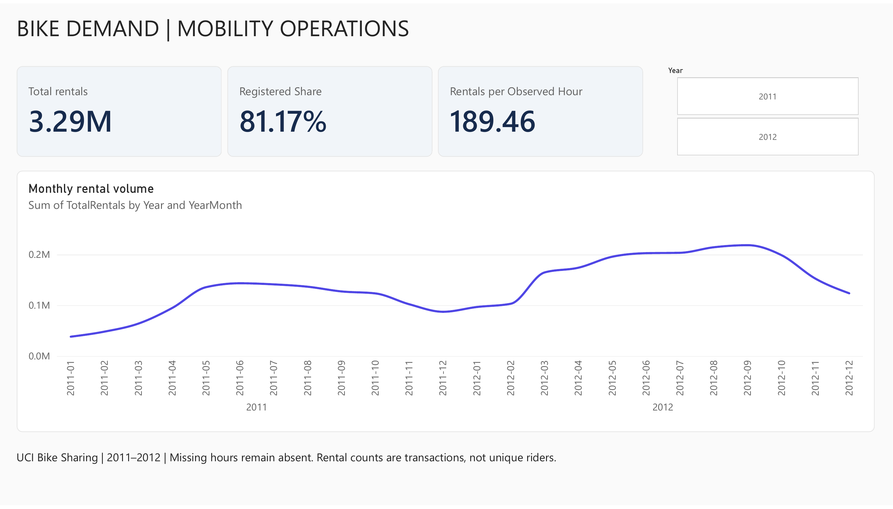
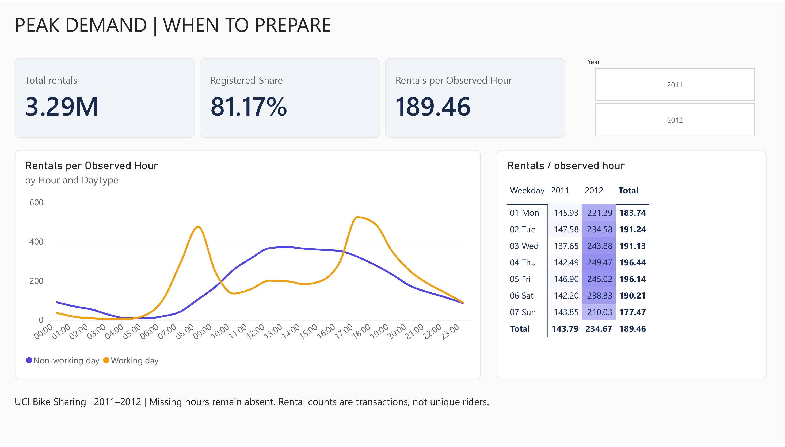
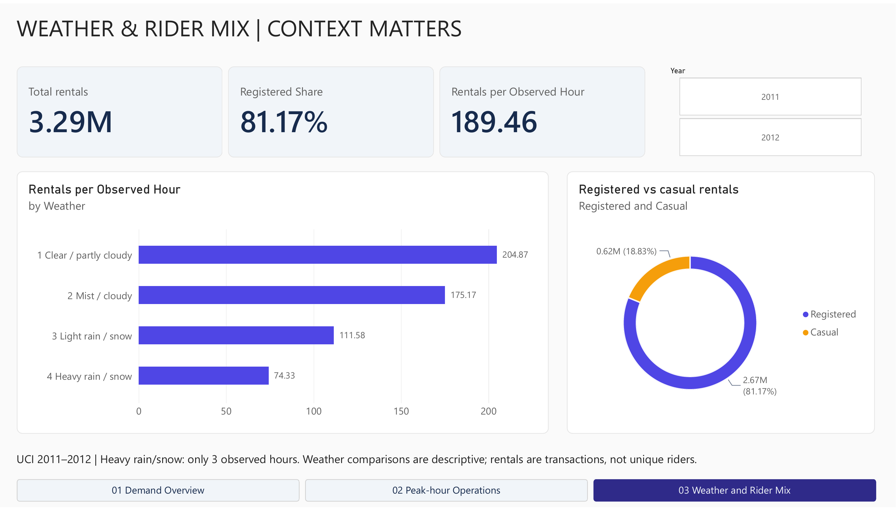

# Bike-sharing demand | Power BI operations analytics

A historical operations-reporting portfolio case study built from the UCI Bike Sharing dataset. It investigates when rental demand is concentrated, how working and non-working days differ, and how calendar and weather mix affect comparisons.

[Editable Power BI report](reports/bike-demand.pbix) · [Report PDF](reports/bike-demand.pdf) · [Findings and proposed actions](reports/findings.md) · [Business brief and KPI definitions](docs/business-brief.md)

## Demand overview



## Peak-hour operations



## Weather and rider mix



## Executive findings

| KPI | Historical result |
| --- | ---: |
| Rental transactions | 3,292,679 |
| Observed hours | 17,379 |
| Observed days | 731 |
| Rentals per observed hour | 189.46 |
| Registered share of rental volume | 81.17% |

Recorded rentals increased **64.88%** from 2011 to 2012. Demand per observed hour increased **63.20%**, accounting for different recorded-hour coverage. Working days peak at **17:00** (525.29 rentals per observed hour); non-working days peak at **13:00** (372.73). These findings motivate further capacity and service-readiness research, not an unsupported fleet or staffing recommendation.

## Reproduce the analysis

```bash
python -m pip install -r requirements.txt
python scripts/analyze.py
```

The script reads original hourly and daily CSVs, validates unique date-hour keys and count identities, reconciles all 731 daily totals, and independently checks totals with SQLite. It creates the labeled source used by Power BI and exports segment summaries. [Power Query](docs/PowerQuery.m), [DAX measures](docs/measures.dax) and the [custom theme](docs/operations-theme.json) are available for review.

## Source, attribution and limits

Fanaee-T, H. (2013). **Bike Sharing** [Dataset]. [UCI Machine Learning Repository](https://archive.ics.uci.edu/dataset/275/bike+sharing+dataset), [DOI 10.24432/C5W894](https://doi.org/10.24432/C5W894), CC BY 4.0. See [source attribution and adaptation notes](data/SOURCE.md), original ZIP and Readme.txt. Source files were downloaded 2026-10-25; the analysis covers 2011–2012 and does not represent current operations.

Rentals are transaction counts, not unique riders. Missing date-hour combinations are not assumed to have zero demand: 165 combinations are absent. Hourly comparisons divide by observed records in the same selected context. Heavy rain/snow has only three observed hours, making its average unreliable. Weather comparisons are associative and may reflect calendar and service mix. There is no station, bike inventory, stockout, revenue or cost data, and no forecast or measured business impact is claimed. This is an independent portfolio exercise, not client work.

The PBIX retains the report's interactive behavior; GitHub images and PDF pages are static snapshots.

## Power BI skills and validation

The report includes an indigo-and-amber theme, live KPI measures, year tiles, an explicit Year → Month → Date drill hierarchy, chronological hourly series, a conditionally formatted weekday matrix, labeled weather comparisons, rider-mix donut and page navigation. [Follow the interaction walkthrough](docs/interaction-guide.md) or [open the saved Power BI assets](docs/power-bi-links.md) with the appropriate account.

The 2012 filter and September 2012 daily drill were tested against source summaries, with the all-year monthly default restored before export. All three PDF pages were rendered and reviewed; the PBIX contains three 1280×720 pages and 18 visual containers. [ReportDefinition](ReportDefinition/) contains JSON extracted from the service-exported PBIX for version review, not a separate packaged Desktop project.
